# Container Diagram — Whiska

Level 2. The deployable and storable pieces. Read the two boundaries as a timeline:
everything in *built* exists and is tested; everything in *designed, not built* is decided
in the ADRs and has no code yet.

```mermaid
C4Container
  title Container Diagram - Whiska

  Person(person, "The person", "Answers one question at a time")
  System_Ext(herdr, "herdr", "Panes, sessions, agent status")
  System_Ext(claude, "Claude Code", "The main session and the mice, in herdr's panes")
  System_Ext(nc, "Desktop notifications", "osascript on macOS, notify-send on Linux")
  System_Ext(remote, "Git remote", "The forge's copy of the repo, where a merge request is merged")
  System_Ext(forge, "Forge API", "GitLab or GitHub: a merge request's state, pipeline and threads")

  Container_Boundary(built, "Built") {
    Container(shim, "whiska.sh", "bash", "Hook shim in the repo or in ~/.claude; asks the owl first, else resolves the runtime at fire time; fails open, with a visible hook error in a worktree. The global copy stands down where the repo has its own")
    Container(statusline, "herdr-status.sh", "bash", "Machine-level status script in ~/.whiska; herdr's tab bar runs it on a timer")
    Container(cli, "whiska", "Elixir escript", "Hooks, init, start, spawn, send, land, pr, drop, mode, shape - and boots the owl")
    Container(owl, "Owl", "Elixir/OTP supervisor", "One per machine; one supervised house per open project")
    Container(house, "House", "GenServer per project", "Herdr subscription, pane discovery, collection, delivery to the main session")
    Container(doorstep, "Doorstep", "directory, .git/whiska/doorstep/", "JSON entries a Stop hook left, removed once collected")
    ContainerDb(db, "House database", "SQLite, .git/whiska/whiska.db", "Mouse records, questions and each collected turn's usage, one per repo")
    Container(marker, "Mouse marker", ".whiska-mouse file", "The opaque mouse_id at the worktree root")
    Container(finishflag, "Finish flag", "empty file, whiska-finish in the main checkout's .git", "A finished line is out and the person has not written since; the shim reads it so a main-session prompt with nothing to settle starts nothing")
    Container(flag, "Answer flag", "empty file, whiska-answer in the worktree's git admin directory", "This worktree's mouse has an answer not yet taken; the shim reads it so a prompt with nothing waiting starts nothing")
    Container(brief, "Brief", ".whiska-brief.md file, or main.md in .git/whiska/", "Everything Whiska tells one session, which Claude Code starts with: a mouse's at its worktree root, git ignores it; the main session's in the house")
    Container(denylist, "Deny list", ".whiska-settings.json file", "A shaped mouse's deny rules, which Claude Code starts with in bypass mode and enforces: the person's commands, and the edit tools for sniff; at its worktree root, git ignores it")
    Container(spec, "Spec", ".whiska-spec.md file", "What a task will build, at the worktree root; the mouse writes it, git ignores it")
    Container(plan, "Build plan", ".whiska-plan.md file", "How a change will be built, beside its spec or a bug's research document; the cold review never reads it, git ignores it")
    Container(kept, "Kept specs", "directory, .whiska/specs/ in the main checkout", "One copy per branch of its spec, build plan, research document and report, each the text alone, named on its mouse's record; overwritten each round, the research and report copies linked from whiska show; git ignores it")
    Container(research, "Research document", ".whiska-research.md file", "What a bug's fix rests on, at the worktree root, git ignores it; an investigation's is its final message instead, and no file")
    Container(reviews, "Diff files", "directory, .whiska/reviews/ in the main checkout", "A finished branch's diff as a plain .diff patch, one file per branch, rewritten on each show, linked from whiska show and opened wherever the person's .diff files open; git ignores it")
    Container(backstop, "Backstop mark", "text file, .git/whiska/backstop", "How much the backstop collected that the idle trigger missed, and when")
    Container(clonelist, "Clone list", "text file, .git/whiska/clone", "Per-repo paths to clone into a new worktree beside the marker defaults, or a lone off; the person writes it")
    Container(record, "Open-houses record", "text file, ~/.whiska/houses", "One main checkout per line; which houses the owl has open")
    Container(owlsock, "owl.sock", "Unix socket, ~/.whiska/", "Read-only and documented: waiting, show one question, the jump list, a house's questions, the tab bar line")
    Container(hooksock, "hook.sock", "Unix socket, ~/.whiska/", "Private: the shim asks it first, and the owl runs the hook's own code; whiska start asks it to open a house")
    Container(svc, "Owl's job", "launchd com.whiska.owl, or systemd whiska-owl.service", "Starts the owl at login, restarts a crash; runs the owl.sh wrapper")
  }

  Container_Boundary(todo, "Designed, not built") {
    Container(sockets, "Repo sockets", "Unix, per-repo", "Push approval, mouse identity")
  }

  Rel(person, cli, "Runs whiska init / init --global / uninstall / shape / owl / questions")
  Rel(claude, cli, "The main session runs spawn, send, land, pr and drop on the person's word; a mouse's deny list refuses them")
  Rel(herdr, statusline, "Tab bar runs it every 5 seconds and shows its last line")
  Rel(statusline, owlsock, "Asks for the line with nc; owl down when nothing answers")
  Rel(owl, owlsock, "Answers waiting, show, jump, questions and line from every recorded house")
  Rel(cli, herdr, "watch works out the sidebar's lines now, reading herdr's panes and workspaces")
  Rel(cli, db, "questions, statusline and waiting read every recorded house")
  Rel(cli, doorstep, "questions, statusline and waiting count what is uncollected")
  Rel(cli, herdr, "mice list panes; doctor reads herdr's config for the tab bar and sidebar rows, and its version")
  Rel(house, nc, "Raises a hoot herdr will not show; doctor probes the same path")
  Rel(cli, herdr, "start types claude, with the main session's brief, at this pane's shell prompt when nothing runs there")
  Rel(cli, brief, "start writes the main session's; spawn and shape write a mouse's")
  Rel(cli, herdr, "spawn creates the worktree and starts Claude in its pane with the brief, the deny list and the shape flags; spawn then types its task there as the first prompt, and send one fixed line")
  Rel(cli, herdr, "drop removes a worktree and its workspace together")
  Rel(cli, remote, "pr pushes a finished branch by name", "git push")
  Rel(cli, forge, "pr opens the merge request with gh or glab")
  Rel(cli, record, "owl reopens from it; start adds this repo when no owl answers; statusline, waiting and doctor read it")
  Rel(cli, hooksock, "start asks the owl running to open this repo", "open 1 <main checkout>")
  Rel(claude, brief, "Reads it once, at start, as part of its system prompt")
  Rel(claude, denylist, "Reads it once, at start, and denies what it lists")
  Rel(claude, shim, "PreToolUse, Stop and UserPromptSubmit fire in a mouse's session, UserPromptSubmit in the main session too")
  Rel(shim, flag, "user-prompt-submit in a mouse exits at once unless it is there")
  Rel(shim, finishflag, "user-prompt-submit in the main session exits at once unless it is there")
  Rel(house, finishflag, "Raises it when it delivers a finished line; the person's next prompt lowers it")
  Rel(shim, hooksock, "Asks first, with nc", "hook name, environment, payload")
  Rel(owl, hooksock, "Runs the same hook modules, with the hook's environment")
  Rel(shim, cli, "Execs with the payload on stdin when the owl does not answer", "JSON")
  Rel(cli, db, "reply saves the answer first; UserPromptSubmit hands it over and stamps it taken")
  Rel(cli, flag, "reply raises it; the take lowers it")
  Rel(cli, herdr, "reply rings the mouse's doorbell - one fixed line, never the answer")
  Rel(cli, marker, "Reads, minting one on first use")
  Rel(cli, db, "shape records a new mouse's mode, model, effort and base branch before Claude starts")
  Rel(cli, spec, "shape makes git ignore it, through the main checkout's info/exclude")
  Rel(cli, research, "shape makes git ignore it, as the spec")
  Rel(cli, plan, "shape makes git ignore it, as the spec")
  Rel(cli, denylist, "shape writes a mouse's, for its mode, and makes git ignore it")
  Rel(cli, doorstep, "Stop hook writes one entry when the owl does not answer")
  Rel(owl, doorstep, "Stop over the hook socket writes the entry; the open house collects it at once")
  Rel(cli, owl, "whiska owl boots it in the foreground")
  Rel(cli, svc, "whiska owl install / stop / start / uninstall", "launchctl or systemctl --user")
  Rel(svc, owl, "Runs whiska owl with no arguments; restarts on a crash only")
  Rel(owl, house, "Opens one per project, supervised independently")
  Rel(owl, record, "Adds a house when opened, removes it when shut")
  Rel(house, herdr, "Subscribes per mouse pane; lists panes to find them")
  Rel(house, doorstep, "Collects on idle, at open, and on a backstop")
  Rel(house, kept, "Keeps the spec, build plan and research document a collected entry carried, and its message when it has a Summary")
  Rel(cli, reviews, "whiska show writes a finished branch's diff; drop removes it with the branch")
  Rel(house, reviews, "Cleanup removes a landed branch's diff with the branch")
  Rel(house, backstop, "Marks what the backstop collected; clears it at open")
  Rel(house, marker, "At open, makes git ignore it, the research document, the build plan and worktrees/, through the main checkout's info/exclude")
  Rel(cli, clonelist, "shape reads it, clones those paths copy-on-write, and excludes each from git")
  Rel(cli, backstop, "doctor reads it: has the last resort been doing the trigger's job")
  Rel(house, db, "Records questions, marks mice dead and removed; reads the next open one")
  Rel(house, db, "Records each collected turn's usage, read from the transcript its entry names")
  Rel(cli, db, "metrics reads usage, waits and spec timing")
  Rel(cli, db, "pr and merge-request record the link the forge's tool printed for a finished branch")
  Rel(house, remote, "Fetches the base alone every minute while a merge request waits, and at once when the forge says merged, in a task, never prompting", "git fetch")
  Rel(house, forge, "Reads each recorded GitLab merge request every minute, in a task, GET only", "glab api")
  Rel(house, doorstep, "Leaves its own question when the forge says closed or gone, then collects it")
  Rel(house, herdr, "Removes a landed worktree, here or in the fetched base, and closes its pane together")
  Rel(house, herdr, "Types one question at a time into the main session when idle")
  Rel(house, herdr, "Rings a mouse's doorbell again, at most three times, while its answer is not taken")
  Rel(house, herdr, "Types a pickup line into a mouse's pane, once, when its turn died")
  Rel(house, herdr, "Hoots: asks herdr to show a notification as it delivers")
  Rel(house, herdr, "Reports each mouse's sidebar line on its workspace; reads them back every 2 s and re-sorts the mice when one changes state, starts or stops queueing behind another, or appears in any state but idle")

  UpdateLayoutConfig($c4ShapeInRow="4", $c4BoundaryInRow="1")
```

## Why each piece is its own container

The reasoning is in the ADR each line names; this is the map.

- **`whiska.sh`**: the committed hook command names only a shim, so nothing machine-specific
  reaches a shared repo; it asks `hook.sock` first and resolves the runtime itself only
  when the owl does not answer (ADR-0035, ADR-0033). The same shim hangs off the repo or
  the home; where both exist, the repo's is in force and the global one stands down
  (ADR-0056).
- **`herdr-status.sh`**: machine-level, in `~/.whiska` beside the owl's `owl.sh`, because
  its line is machine-wide; it asks `owl.sock` and starts nothing (ADR-0048). No script runs per repo:
  each mouse's state is a sidebar line the house reports to herdr directly (ADR-0082).
- **`owl.sock` and `hook.sock`**: one read-only and documented, for scripts and the tab
  bar; one private, for the hooks and `whiska start`'s request to open its house. Neither is the per-repo socket still designed only
  (ADR-0033, ADR-0024).
- **Open-houses record**: the one machine-level file; which houses the owl has open, not
  which exist (ADR-0039, ADR-0003).
- **House database under the main checkout's `.git/`**: every worktree shares it, so a
  repo's mice are one house; SQLite, not flat files (ADR-0028). Each turn's usage is
  stored there at collection, keyed by its question
  (ADR-0086).
- **Doorstep, a directory in the house**: every question enters through it, whoever writes
  the entry; a dead owl loses nothing; collected entries are removed, the row being the history, and an
  ordinary `whiska drop` cannot erase a question still waiting (ADR-0036, ADR-0007).
- **Backstop mark**: per house, so the doctor's one line is about this run of this house
  (ADR-0036).
- **Mouse marker**: the opaque `mouse_id`, never the branch or path (ADR-0002).
- **Brief, one file per session**: everything Whiska tells a session, on Claude Code's
  launch line, so it is in the system prompt from the first turn and stays there; a
  mouse's is git-ignored at its worktree root, the main session's sits in the house so a
  checkout holds no file of Whiska's (ADR-0088).
- **Deny list, one file per mouse**: what a mouse's mode forbids and the person's commands,
  on Claude Code's launch line, so Claude Code enforces it from the first tool call; it is
  read once, which is why the hold, set while a mouse runs, stays in the hook
  (ADR-0090).
- **Answer flag and finish flag**: hints for the shim, never the answer or the slot, which
  are in the house database (ADR-0080, ADR-0008).
- **Spec and build plan in the worktree, kept copies in the main checkout**: both live and
  die with their mouse; the copies, side by side, are the archive (ADR-0063). The build
  plan is a separate file so the cold review can be kept from it (ADR-0049).
- **Research document in the worktree, its kept copy beside the kept spec**: the mouse
  writes and rewrites its own; the copy is one per branch, overwritten each round, so the
  link the person and the build follow opens the latest and outlives the worktree
  (ADR-0074).
- **The owl's job**: the platform's service manager runs the wrapper, restarts a crash only
  (ADR-0040).
- **One owl, many houses**, each supervised independently (ADR-0001). Delivery lives in the
  house, and nothing types across houses (ADR-0008, ADR-0044).
- **herdr is the one boundary with a fake behind it** (ADR-0031).
- **Off the machine, the owl reaches two things, and only while a merge request waits**:
  the git remote, through git alone, for the base branch alone (ADR-0087); and for a
  GitLab request the forge's API, through the person's `glab` login and one runner that
  builds only a `GET` (ADR-0060). `whiska pr` reaches both too, on the person's word: a
  push by the branch's name, and the forge's own `gh` or `glab` to open the merge request
  (ADR-0085).

## Designed only

The per-repo sockets with the peer-process check (ADR-0024); `whiska stop` for one house
(ADR-0003); push approval (ADR-0011); relaunching a stuck mouse (ADR-0026, ADR-0067);
waking a mouse about what the owl read of its merge request (ADR-0060).
